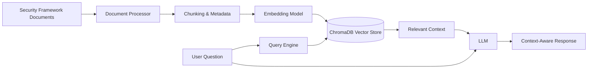

# ISMS RAG Platform

A Retrieval-Augmented Generation (RAG) platform designed to make information-security frameworks easier to query, explore, and compare through natural-language interaction.

The project combines document processing, semantic search, vector retrieval, and LLM-based response generation for ISMS and cybersecurity compliance use cases.

## Overview

Security frameworks such as ISO/IEC 27001, NIST CSF, and CIS Controls contain large amounts of structured guidance that can be difficult to navigate manually.

This project implements a RAG workflow that:

1. Processes security-framework documents
2. Splits them into retrievable chunks
3. Generates semantic embeddings
4. Stores them in ChromaDB
5. Retrieves relevant context for a user query
6. Uses an LLM to generate a context-aware response

The platform supports both **English and French** queries.

## Architecture



## Core Components

### Document Processing

`src/document_processor.py`

Handles document loading, text extraction, chunking, and metadata preparation before ingestion into the vector database.

### Vector Store

`src/vector_store.py`

Provides persistent ChromaDB storage and semantic retrieval for framework content.

### Framework Ingestion

`src/ingest_frameworks.py`

Processes framework documents and loads their embeddings into the configured ChromaDB collection.

### RAG Query Engine

`src/query_engine.py`

Implements the retrieval and generation workflow.

The query engine:

- retrieves semantically relevant framework content
- builds contextual prompts
- supports English and French
- supports OpenAI or local Ollama-based generation
- returns responses grounded in retrieved context

### Interactive Demo

`src/demo.py`

Provides an interactive interface for testing framework questions and exploring the RAG workflow.

## Technology Stack

| Area | Technology |
|---|---|
| Language | Python |
| RAG | Retrieval-Augmented Generation |
| Vector Database | ChromaDB |
| Embeddings | Sentence Transformers |
| LLM | Ollama / OpenAI |
| Configuration | Environment variables |
| Testing | Python test suite |
| Security Domain | ISMS & cybersecurity compliance |

## Example Use Cases

The platform can support questions such as:

```text
What controls are relevant to access management?
```

```text
How does ISO 27001 address information-security risk?
```

```text
What security measures relate to incident response?
```

```text
Quels contrôles concernent la gestion des accès ?
```

The objective is not to replace the original standards, but to provide a faster interface for locating and understanding relevant security guidance.

## Configuration

Create your local environment file:

```bash
cp .env.example .env
```

The main configuration options include:

```text
OPENAI_API_KEY
LLM_MODEL
LLM_TEMPERATURE
MAX_TOKENS
EMBEDDING_MODEL
CHROMA_PERSIST_DIRECTORY
CHROMA_COLLECTION_NAME
CHUNK_SIZE
CHUNK_OVERLAP
DEFAULT_LANGUAGE
TOP_K_RESULTS
SIMILARITY_THRESHOLD
```

For a local LLM workflow, Ollama can be used instead of an external LLM provider.

Actual credentials must never be committed to the repository.

## Repository Structure

```text
isms-rag-platform/
├── src/
│   ├── config.py
│   ├── demo.py
│   ├── document_processor.py
│   ├── ingest_frameworks.py
│   ├── query_engine.py
│   └── vector_store.py
├── tests/
├── test_document_processor.py
├── test_e2e.py
├── test_query_engine.py
├── test_vector_store.py
├── verify_setup.py
├── requirements.txt
├── .env.example
├── .gitignore
└── README.md
```

Generated vector databases, local framework documents, environment files, model artifacts, and virtual environments are intentionally excluded from the public repository.

## Testing

The project contains tests covering the main RAG components, including:

- document processing
- vector-store operations
- query-engine behavior
- end-to-end retrieval workflow

Example:

```bash
pytest
```

A setup verification utility is also included:

```bash
python verify_setup.py
```

## Privacy & Local AI

The architecture supports **Ollama-based local inference**, allowing sensitive security documentation to be processed without necessarily sending the retrieved context to an external LLM API.

This makes the approach particularly relevant for ISMS and compliance scenarios involving internal or sensitive documentation.

## What This Project Demonstrates

- Retrieval-Augmented Generation
- semantic search
- vector databases
- document chunking and embeddings
- LLM integration
- local LLM usage with Ollama
- bilingual RAG workflows
- security-framework knowledge retrieval
- ISMS and cybersecurity compliance automation
- Python application architecture

## Security Notice

This repository is a sanitized portfolio version of the project.

The following are intentionally excluded:

- `.env` files
- API credentials
- generated ChromaDB databases
- source framework documents
- local vector embeddings
- virtual environments
- test databases
- cached Python artifacts

The repository contains implementation code and configuration examples only.

## Disclaimer

Generated responses should be treated as an aid for navigating security documentation and not as a substitute for consulting the authoritative version of a standard or framework.

## License

MIT
