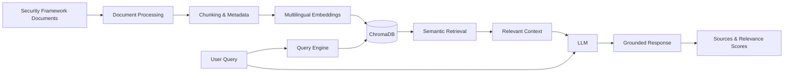

# ISMS RAG Platform

A bilingual Retrieval-Augmented Generation (RAG) platform for querying information-security frameworks and compliance documentation through natural language.

The project combines document processing, multilingual embeddings, semantic retrieval, vector storage, and LLM-based response generation to make standards such as **ISO/IEC 27001, NIST Cybersecurity Framework, and CIS Controls** easier to explore.

## Project Overview

Security frameworks contain large amounts of structured guidance that can be difficult to navigate manually.

The ISMS RAG Platform provides a workflow that can:

- ingest security-framework documents
- extract and normalize text and metadata
- split documents into configurable chunks
- generate multilingual embeddings
- persist embeddings in ChromaDB
- retrieve semantically relevant controls and requirements
- filter results by security framework
- generate context-aware answers using an LLM
- return supporting source information and relevance scores
- answer questions in both **English and French**

The platform supports **local LLM inference with Ollama** as well as optional OpenAI integration.

## RAG Architecture



## Supported Knowledge Sources

The ingestion pipeline is designed for security and compliance content such as:

- **ISO/IEC 27001**
- **NIST Cybersecurity Framework**
- **CIS Critical Security Controls**
- internal security policies
- other structured security documentation

Framework source documents themselves are intentionally excluded from the public repository.

## Core Capabilities

### Multi-Format Document Processing

The document-processing pipeline supports:

- PDF
- DOCX
- TXT

It performs:

- text extraction
- configurable chunking
- overlapping context windows
- metadata preservation
- framework identification
- preparation for vector ingestion

Implementation:

```text
src/document_processor.py
```

### Semantic Search

Documents are embedded using multilingual Sentence Transformer models and stored in **ChromaDB**.

The retrieval layer supports:

- persistent vector storage
- semantic similarity search
- configurable top-K retrieval
- similarity thresholds
- framework-specific filtering
- relevance scoring

Implementation:

```text
src/vector_store.py
```

### Framework Ingestion

The ingestion workflow processes framework documents and loads them into the vector database.

```text
src/ingest_frameworks.py
```

Typical flow:

```text
Documents
   ↓
Parsing
   ↓
Chunking
   ↓
Metadata
   ↓
Embeddings
   ↓
ChromaDB
```

### RAG Query Engine

The query engine combines retrieved framework context with a language model.

Implementation:

```text
src/query_engine.py
```

It supports:

- semantic context retrieval
- English and French prompts
- framework filtering
- source-aware responses
- configurable generation parameters
- Ollama-based local inference
- optional OpenAI inference

### Local LLM Support

The platform supports **Ollama** for local inference.

This allows security documentation and retrieved context to remain on the local machine instead of necessarily being transmitted to an external LLM provider.

Compatible local models can include models such as:

```text
llama3.2
mistral
qwen
```

OpenAI integration is also available through environment configuration.

### Interactive Demo

An interactive command-line interface is included:

```bash
python src/demo.py
```

The demo supports:

- custom questions
- French example questions
- English example questions
- knowledge-base statistics
- interactive exploration of retrieved security guidance

## Example Queries

English:

```text
What controls are relevant to access management?
```

```text
How does ISO 27001 address information-security risk?
```

```text
What guidance is relevant to incident response?
```

French:

```text
Quelles sont les exigences liées au contrôle d'accès ?
```

```text
Comment gérer les incidents de sécurité selon les référentiels disponibles ?
```

The platform is designed to help locate relevant material quickly rather than replace the authoritative framework documents.

## Technology Stack

| Area | Technology |
|---|---|
| Language | Python |
| RAG | Retrieval-Augmented Generation |
| Document Processing | LangChain, PyPDF, python-docx |
| Embeddings | Sentence Transformers |
| Vector Database | ChromaDB |
| Local LLM | Ollama |
| Optional External LLM | OpenAI |
| Interface | Interactive CLI |
| Configuration | Environment variables |
| Domain | ISMS, cybersecurity & compliance |

## Configuration

Create a local configuration file:

```bash
cp .env.example .env
```

Important settings include:

```text
OPENAI_API_KEY
LLM_MODEL
LLM_TEMPERATURE
MAX_TOKENS

EMBEDDING_MODEL

CHROMA_PERSIST_DIRECTORY
CHROMA_COLLECTION_NAME

CHUNK_SIZE
CHUNK_OVERLAP

DEFAULT_LANGUAGE
SUPPORTED_LANGUAGES

TOP_K_RESULTS
SIMILARITY_THRESHOLD
```

Example retrieval configuration:

```text
CHUNK_SIZE=1000
CHUNK_OVERLAP=200
TOP_K_RESULTS=5
SIMILARITY_THRESHOLD=0.7
```

Actual credentials belong only in the local `.env` file and must never be committed.

## Quick Start

### 1. Clone the repository

```bash
git clone https://github.com/Yahmedd/isms-rag-platform.git
cd isms-rag-platform
```

### 2. Create a virtual environment

Windows:

```bash
python -m venv venv
venv\Scripts\activate
```

Linux/macOS:

```bash
python -m venv venv
source venv/bin/activate
```

### 3. Install dependencies

```bash
pip install -r requirements.txt
```

### 4. Configure the environment

```bash
cp .env.example .env
```

### 5. Optional: use a local Ollama model

```bash
ollama pull llama3.2
```

### 6. Verify the environment

```bash
python verify_setup.py
```

### 7. Ingest framework documents

Place your authorized framework or policy documents in your local data directory, then run:

```bash
python src/ingest_frameworks.py
```

### 8. Start the interactive demo

```bash
python src/demo.py
```

## Programmatic Usage

Example initialization:

```python
from src.vector_store import VectorStore, RAGRetriever
from src.query_engine import ISMSQueryEngine, ISMSAssistant

vector_store = VectorStore(
    collection_name="isms_frameworks",
    persist_directory="./chroma_db"
)

retriever = RAGRetriever(vector_store)

engine = ISMSQueryEngine(
    retriever=retriever,
    language="en",
    model="llama3.2",
    use_ollama=True
)

assistant = ISMSAssistant(engine)

answer = assistant.ask(
    "What controls are relevant to access management?",
    framework="iso27001",
    language="en"
)

print(answer)
```

## Repository Structure

```text
isms-rag-platform/
├── src/
│   ├── __init__.py
│   ├── config.py
│   ├── demo.py
│   ├── document_processor.py
│   ├── ingest_frameworks.py
│   ├── query_engine.py
│   └── vector_store.py
│
├── tests/
│   └── __init__.py
│
├── test_document_processor.py
├── test_e2e.py
├── test_query_engine.py
├── test_vector_store.py
├── verify_setup.py
├── requirements.txt
├── .env.example
├── .gitignore
├── SECURITY.md
├── LICENSE
└── README.md
```

Generated databases, framework documents, virtual environments, and local configuration files are intentionally excluded.

## Testing

The project includes component and end-to-end validation for:

- document processing
- vector-store operations
- query-engine behavior
- retrieval workflows
- environment configuration

Run the available tests with:

```bash
pytest
```

Individual tests can also be executed directly:

```bash
python test_document_processor.py
python test_vector_store.py
python test_query_engine.py
python test_e2e.py
```

Environment verification:

```bash
python verify_setup.py
```

## Security & Privacy

Security documentation can contain sensitive internal information.

For that reason, the project supports a local architecture using:

```text
Local documents
      ↓
Sentence Transformer embeddings
      ↓
Local ChromaDB
      ↓
Local Ollama LLM
```

This allows the RAG workflow to operate without necessarily sending document content to an external AI service.

The public portfolio repository does not include:

- private framework documents
- organizational policies
- `.env` files
- API credentials
- generated vector embeddings
- ChromaDB databases
- cached models
- virtual environments
- test databases
- Python cache files

## What This Project Demonstrates

- Retrieval-Augmented Generation
- security-focused AI applications
- semantic search
- multilingual embeddings
- vector databases
- document ingestion pipelines
- metadata-aware retrieval
- source-aware answer generation
- configurable similarity retrieval
- Ollama local LLM integration
- optional OpenAI integration
- bilingual English/French workflows
- ISO 27001 / NIST / CIS knowledge retrieval
- Python software architecture
- privacy-conscious AI design

## Portfolio Context

This project explores the intersection of:

**Cybersecurity + Compliance + Artificial Intelligence**

It demonstrates how RAG can be applied to security-framework navigation while keeping retrieval grounded in the source documentation.

## Disclaimer

Generated responses are intended to assist with locating and understanding relevant security guidance.

They should not be treated as authoritative compliance advice or as a replacement for consulting the official version of a standard or framework.

## Security

See [SECURITY.md](SECURITY.md) for repository security guidance.

- [LLM threat model (OWASP Top 10 for LLM Applications 2025 + NIST AI RMF)](docs/threat-model-llm.md)

## License

MIT License.
